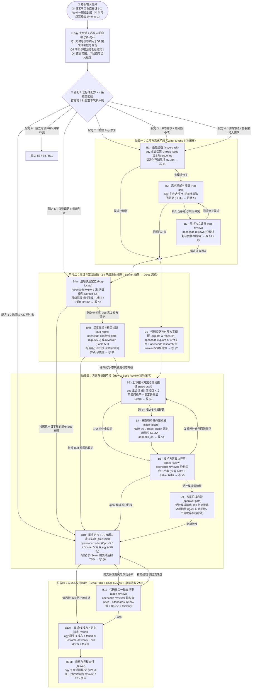

# opencode-goal-pipeline

> AGY + Magpie 接入与更新检查见 [维护文档](agy-magpie-harness/docs/agy-magpie-recovery.md)，跟踪 [Issue #20](https://github.com/wycocoyu/opencode-goal-pipeline/issues/20)。该文优先于下文早期的桌面模型数量与 Magpie/OpenCode 路由描述。OpenCode 直接使用 `opencode run`，不接入 Magpie。

**`agy`（Gemini / GPT-6 Astra / GPT-6.1 Sol 深度需求澄清 + 原生 `/goal` 长任务主控 + 多模态/GUI 真机验收交付）$\times$ `opencode run`（全能后台异构执行底座：按场景灵活调度 `explore` / `research` / `coder` / `reviewer` / `general` 与 CLI 测试）四大阶段 12 块标准积木（`B1`~`B12`）协同流水线**。

---

## 〇、端到端全景链路图（`agy` 主控 $\times$ `opencode run` 全能后台 $\times$ 单写者 `issue.md`）

### 1. 全景 Mermaid 架构与动态选块链路图（GitHub 原生渲染）



### 2. 竖排控制流与数据流链路图（终端速览版）

```text
[老板输入：日常直接说 / /goal 一键跑到底 / 手动点菜插拔]
  ↓
[agy 主会话 (Gemini / GPT-6 Astra / GPT-6.1 Sol)：跑「4 问自检 Q1~Q4」选出配方，首轮第 1 行宣告积木链]
  ↓
┌──────────────────────────────────────────────────────────────────────────────────────────┐
│ 阶段一：立项与需求阶段（写 issue.md §1 + §5）                                             │
│   B1 (issue-track) ：agy 主会话建 GitHub Issue 或本地 issue.md，初始化已知 R1..Rn         │
│   ↓（若存在查代码定不下的用户可感知分叉）                                                  │
│   B2 (req-grill)   ：agy 主会话带 ➡️ 正向推荐追问老板，答「可以」即采纳                   │
│   ↓（若需求与现码/规则冲突、疑似伪命题或老板点名审需求）                                    │
│   B3 (req-review)  ：调 opencode run --agent reviewer --auto 只读挑刺 Why，结论回主会话   │
└──────────────────────────────────────────────────────────────────────────────────────────┘
  ↓
┌──────────────────────────────────────────────────────────────────────────────────────────┐
│ 阶段二：取证与定位阶段（写 issue.md §2 现状根因与代码复用锚点）                            │
│   • Bug 任务（B4 两级渐进排障，不拆新子 Agent，复用 explore + coder/reviewer 模型分层）：│
│     1) B4a (bug-locate 浅层秒级定位)：调 opencode explore（默认快模型 Sonnet 5.5）       │
│        秒级抓「报错时间线 + 异常堆栈 + 精确 file:line + 现有测试命令」                    │
│        → 若原因已 100% 一目了然（简单 Bug），直接跳过 B4b 进 B10 修复！                   │
│     2) B4b (bug-repro 深度复现查根)：复杂/未坐实 Bug 调 opencode coder（Opus 5.5）       │
│        构造最小红灯复现命令/单测并深挖根因（或调 explore Opus / reviewer Fable 破局）    │
│   • 非 Bug 任务 → B5 (explore & research)：调 opencode explore 查本仓复用                 │
│                                            + 调 opencode research 查 memex 与 500 星开源  │
└──────────────────────────────────────────────────────────────────────────────────────────┘
  ↓
┌──────────────────────────────────────────────────────────────────────────────────────────┐
│ 阶段三：方案与拆图阶段（写 issue.md §3 + §4 + §5，对称闭环）                              │
│   B6 (spec-draft)    ：agy 主会话设计模块深接口、过复用四问梯子、锁定最高层公共测试接缝 Seam│
│   ↓（若跨 3+ 模块或多步长链路，依赖 B6 拆图；否则跳过 B7 不造空 S1）                       │
│   B7 (slice-tickets) ：agy 主会话按 Tracer-Bullet 切出端到端垂直切片 S1..Sn 与 depends_on │
│   ↓                                                                                      │
│   B8 (spec-review)   ：调异构 opencode reviewer 三合一冷审（高风险/点名上 Astra+Fable 双审）│
│   ↓（受控模式停在 B9 输出 ≤10 行简报等老板拍板；/goal 模式跳过常规 B9，四道硬停机线除外）  │
│   B9 (approval-gate) ：老板确认后进入编码                                                 │
└──────────────────────────────────────────────────────────────────────────────────────────┘
  ↓
┌──────────────────────────────────────────────────────────────────────────────────────────┐
│ 阶段四：实施与交付阶段（写 issue.md §5 + §6 交付与持久验收证据）                          │
│   B10 (slice-impl)      ：调 opencode run --agent coder --auto（传五项最小完整交接包指针）│
│                           锁定 §3 Seam 跑先红后绿 TDD（<20 行低风险小改由 agy 直接改）    │
│   ↓                                                                                      │
│   B11 (code-review)     ：调异构 opencode reviewer 审 Spec + Fowler 12 坏味道 + 复用精简  │
│                           （需精简/修复项回流 B10 落盘重测；仅低风险 <20 行微改可跳过）    │
│   ↓                                                                                      │
│   B12a (verify)         ：agy 原生多模态 + tabbit-cli + chrome-devtools + cua-driver      │
│                           + tester 执行浏览器/GUI/长链路真机验收（CLI/调研任务验命令/报告）│
│   ↓                                                                                      │
│   B12b (deliver)        ：agy 唯一执笔回填 issue.md §6，在授权边界内执行 Commit / PR / 关单│
└──────────────────────────────────────────────────────────────────────────────────────────┘
```

---

## 一、平时在 `agy` 使用 Gemini / GPT 的三档触发 + 4 问自检 + 6 套标准配方

唯一权威规程见 [`skills/team-dual-goal/SKILL.md`](skills/team-dual-goal/SKILL.md)，日常使用只需掌握以下三档触发方式：

1. **日常零口令直接说（默认推荐）**：
   - 直接说需求或贴报错，主会话自动跑下方「4 问自检」并在首轮顶部一行宣告本次选中的积木链（如 `本次走 [配方 2 · Bug 修复]：B1 -> B4 -> B10 -> B12`），随即开工。
2. **长任务一键跑到底（在 `agy` 输入 `/goal <目标>`）**：
   - 自动拔掉常规方案拍板门禁 `B9 (approval-gate)`，从取证、方案、冷审、TDD 实施到真机验收一气呵成跑完。
   - **四道硬停机红线在 `/goal` 下不可拔除**：① 存在查代码也无法确定的用户可感知需求分叉、② 缺凭证/权限或触及未授权的外部/不可逆写操作（`git push`、提 PR、删数据、生产库/部署）、③ 同一故障修复验证连续失败 3 次、④ 老板显式声明「只出方案 / 先不改代码」。
3. **手动点菜 / 插拔（第一优先级 Priority 1）**：
   - 随时说「先跑 `B3` 审一下这个需求」「让 Astra 和 Fable 双审 `B8` 方案」「跳过调研直接改」，Agent 立即按指令重排或裁剪积木。

### 自动选块「4 问自检」算法

```text
收到任务后，主会话在脑中按顺序只判断四件事（不在回复里展开自检过程）：
Q1（交付与授权终点）：本次是只读排查/咨询、只出方案、写代码验证，还是已获授权对外交付（push / PR / 关单）？
Q2（需求清晰度与真伪）：是否存在查代码也无法确定的用户可感知分叉（是 → 插 B2: req-grill）？需求本身是否与现码/既有规则冲突或疑似伪命题（是 → 插 B3: req-review）？
Q3（事实与根因是否已证实）：是否是异常/Bug（是 → 先插 B4a: bug-locate 调 explore 快模型 Sonnet 秒级定位报错时间线与 file:line；若根因仍未 100% 坐实或需构造红灯复现，再进 B4b: bug-repro 用 Opus 深挖）？非 Bug 任务是否涉及未知调用链或需查 memex / 500 星开源成熟方案（是 → 插 B5: explore & research）？
Q4（变更范围、风险面与切片粒度）：是否跨文件改接口/状态机或需设计取舍（是 → 插 B6: spec-draft + B8: spec-review；多步端到端改动再依赖 B6 插 B7: slice-tickets）？是否触及鉴权、并发、迁移、计费等高风险面或跨模块逻辑（是 → 必插 B11: code-review，严禁按行数豁免）？
```

### 6 套标准配方速查

| 配方 | 适用场景 | 自动拼装的积木链 |
| :--- | :--- | :--- |
| **配方 1 · 低风险随手小改** | 明确的单文件 `<20 行` 低风险改文案/调配置/微补丁 | `[B1] -> B10 -> B12a` |
| **配方 2 · 常规 Bug 修复** | 报错明确或可本地复现的故障修复（先 `B4a` 秒级快筛，按需进 `B4b` 复现查根；若遇协议/状态机改动动态补 `B6 -> B8`） | `B1 -> B4a -> [B4b] -> B10 -> [按风险挂 B11] -> B12` |
| **配方 3 · 中等明确需求 / 高风险小改** | 需求清楚但跨文件改逻辑，或触及鉴权/并发/迁移/计费等高风险面 | `B1 -> B5 -> B6 -> B8 -> B10 -> B11 -> B12` |
| **配方 4 · 模糊想法或复杂架构大需求** | 需求待磨清、涉及多模块重构或分片交付 | `B1 -> B2 -> [B3] -> B5 -> B6 -> B7 -> B8 -> [B9] -> B10 -> B11 -> B12` |
| **配方 5 · 纯调研 / 排障定位 / 架构咨询（只读）** | 只查根因、调研开源方案或出设计评估，不改业务代码 | `[B1] -> B4/B5 -> [B6 -> B8] -> B12a` |
| **配方 6 · 独立专项评审（只审不改）** | 对已有需求、方案或代码 diff 做独立冷审 | 单独运行 `B3`、`B8` 或 `B11` |

---

## 二、四大阶段 12 块全量标准积木菜单（`B1`~`B12`）与 `issue.md` 六节契约映射

> **核心不变量**：**积木是可选动作，不是必填章节、独立文件或必派子 Agent。** 一个动作可复用已有证据，多个动作可更新同一章节，**跳过某个动作不等于删除该动作负责的不变量**。所有节点产出统一收束进单张权威主卡 `issue.md` 或 GitHub Issue 正文（**由 `agy` 主会话唯一执笔 Single-Writer**，默认阅读预算 `~120 行`，`R1..Rn` 需求零删减）。

| 阶段 | 积木代号与名称 | 解决什么问题（借鉴来源） | 默认执行方 | 对应 `issue.md` 章节 | 何时插上（适用场景） | 何时跳过（裁剪判据） |
| :--- | :--- | :--- | :--- | :--- | :--- | :--- |
| **一、立项与需求阶段** | **`B1` · 任务建档 (`issue-track`)** | 建 GitHub Issue 或本地 `issue.md` 权威主卡并初始化已知 `R1..Rn`（BMAD *"The ticket is the spec"*） | `agy` 主会话 | 建卡并初始化 **§1** | 新需求、Bug 修复、问题排查（遵循目标仓留痕规则） | 已在当前卡内跟进，或无卡仓库的 `<20 行` 低风险微改 |
| **一、立项与需求阶段** | **`B2` · 需求理解与澄清 (`req-grill`)** | 追问对齐老板真实意图与边界，每问必带正向推荐选项（Matt `grill-me` `#1193` + `team-grilling`） | `agy` 主会话（`HITL`） | **§1 需求与不改边界 (`R1..Rn` + `Out of Scope`)** | 存在查代码也无法确定的用户可感知分叉（≥2 个未决点提议开磨，1 个直接问） | 老板需求、验收标准与边界已经表达清楚时直接跳过 |
| **一、立项与需求阶段** | **`B3` · 需求独立评审 (`req-review`)** | 跳出给定框架审视需求必要性（Why）、是否与现码/既有规则冲突或属伪命题（本土对称闭环 `#6`） | `opencode reviewer`（`AFK` 只读返回主会话） | **§1 + §5 Review & Decision Log** | 需求与现码/规则冲突、疑似伪命题、代价过高或老板点名审需求 | 常规明确需求、确定性 Bug 修复直接跳过 |
| **二、取证与定位阶段** | **`B4` · 两级渐进排障：浅层快速定位 (`B4a: bug-locate`) + 深度复现查根 (`B4b: bug-repro`)** | • **`B4a` 浅层秒级定位（默认必跑）**：调只读 `explore`（快模型 `Sonnet 5.5`）秒级提取「报错时间线 + 异常堆栈与 `file:line` + 现有测试命令」（简单 Bug 直接跳过 `B4b` 进 `B10`）<br>• **`B4b` 深度复现与根因诊断（复杂/未坐实 Bug 必跑）**：由 `coder`（`Opus 5.5`）构造最小红灯复现命令/单测并深挖根因（`team-diagnosing-bugs`） | `B4a`：`opencode explore`（默认 `Sonnet 5.5`）<br>`B4b`：`opencode coder` / `explore`（`Opus 5.5`）或 `reviewer`（`Fable 5.1`） | **§2 现状根因与代码复用锚点** | 线上/本地报错、行为异常、性能退化等 Bug 排障任务（先 `B4a` 快筛，按需进 `B4b` 深挖） | 新功能开发、纯文档/配置调整，或根因 `file:line` 已在输入中 100% 坐实 |
| **二、取证与定位阶段** | **`B5` · 代码探路与外部方案调研 (`explore & research`)** | 非 Bug 任务查本仓现成可复用实现（`explore`/`scout`）+ 查 `memex` 与 500 星开源成熟方案（`research`） | `opencode explore` / `opencode research`（只读） | **§2 现状根因与代码复用锚点** | 非 Bug 任务涉及未知调用链、新架构选型、跨模块改造或需对照开源方案 | Bug 任务（已由 `B4` 覆盖探路）或本仓几行代码一目了然的小改 |
| **三、方案与拆图阶段** | **`B6` · 起草技术方案与测试接缝 (`spec-draft`)** | 设计模块深接口、过复用四问梯子、锁定最高层公共测试接缝 Seam（Matt `write-a-prd` + `team-codebase-design`） | `agy` 主会话 | **§3 精简技术方案与公共测试接缝 (Seams)** | 涉及跨文件改动、接口/状态机调整、存在多种实现路线需取舍 | 单点机械小改、纯文案/配置修改（跳过时验证命令直记 `§6`） |
| **三、方案与拆图阶段** | **`B7` · 垂直切片任务图拆解 (`slice-tickets`)** | **依赖 `B6`**：按端到端可独立验证的 Tracer-Bullet 切出 `S1..Sn` 与 `depends_on` 阻塞边（Matt `prd-to-issues`） | `agy` 主会话 | **§4 垂直切片任务图 (`S1..Sn`)** | 跨 3 个以上模块、多步长链路或需多 worktree 分步交付的大任务 | 1~2 步即可改完测通的中小任务（跳过时 `R1..Rn` 直接关联 `§6`） |
| **三、方案与拆图阶段** | **`B8` · 技术方案独立评审 (`spec-review`)** | 针对 `B6`（及已启用的 `B7`）做三合一独立冷审（按需单审或 `Astra + Fable` 双审，`team-review-governance`） | `opencode reviewer`（相对 `B6` 作者模型异构，只读） | **§5 Review & Decision Log** | 凡启用了 `B6 (spec-draft)` 的中大型方案或架构改动默认必配 | 未启用 `B6` 的小改，或老板明确说「不用审方案直接写」 |
| **三、方案与拆图阶段** | **`B9` · 方案拍板门禁 (`approval-gate`)** | 改动业务代码前输出 `≤10 行` 方案与取舍简报，等待老板点头后再动代码 | `agy` 主会话（`HITL`） | **§5 Review & Decision Log** | 老板要求「先看方案再改」、或方案存在影响用户体验的重大取舍未拍板 | 老板已下令「直接改完」或开启 `/goal`（注：四道硬停机红线不可拔除） |
| **四、实施与交付阶段** | **`B10` · 垂直切片 TDD 编码 / 定向实施 (`slice-impl`)** | 代码改动锁定 `§3` Seam 跑「先红后绿」TDD，文档/配置改动执行引用与加载实现，并承接 `B11` 精简回流 | `opencode coder`（`<20 行` 低风险小改可由 `agy` 直接改） | **§6 交付与持久验收证据** | 所有需要修改代码、脚本、配置或文档的任务 | 纯只读调研、纯排障咨询或纯评审任务 |
| **四、实施与交付阶段** | **`B11` · 代码三合一独立评审 (`code-review`)** | 对照 `R1..Rn` 审漏做/越界（`Spec`）、Fowler 12 坏味道（`Standards`）与复用精简（`Reuse & Simplify`），结论回流 `B10` | `opencode reviewer`（相对 `B10` 作者模型异构，只读） | **§5 + §6** | 所有跨文件改动、核心逻辑变更，以及触及鉴权/并发/迁移/计费的几行高风险修改 | 仅限低风险且一眼可核实的单文件 `<20 行` 文案/配置/机械微改 |
| **四、实施与交付阶段** | **`B12` · 真机/多模态验收与授权交付 (`verify & deliver`)** | 内分两段：<br>• **`B12a` 真机/多模态与定向验收**：UI/浏览器/桌面用 `agy` 多模态 + `tabbit-cli` + `chrome-devtools` + `cua-driver` + `tester`，CLI/调研验命令或结论<br>• **`B12b` 归档与授权交付**：回填 `§6` 并在授权边界内执行 Commit / PR / 关单 | **`agy` 主会话主导**（可配合 `opencode` 跑 CLI 测试套件） | **§6 交付与持久验收证据** | `B12a` 所有任务必跑；`B12b` 在任务收尾及具备外部写授权时执行 | `B12a` 永不跳过；未获 `push`/PR/部署授权时停在本地验证完毕并请示 `B12b` |

---

## 三、常见输入示例（在 `Antigravity` 对话框中直接输入）

```text
# 示例 1：想法还比较模糊，先磨需求并审视需求真伪（配方 4 前段：B1 -> B2 -> B3 -> B5 -> B6 -> B8 -> B9）
我想给列表页加一个批量导出功能，具体规则还没定，先帮我做需求澄清和需求评审，磨清后再出技术方案等我拍板

# 示例 2：常规 Bug 一键跑到底（配方 2 + /goal：B1 -> B4 -> B10 -> B11 -> B12）
/goal 修复导出空数组时的崩溃问题，跑通复现红灯与修复绿灯并完成代码三合一审查

# 示例 3：复杂需求先出方案并通过 Astra + Fable 双审（B1 -> B5 -> B6 -> B7 -> B8 双审 -> B9）
梳理并设计多租户权限隔离方案，起草技术方案后让 Astra 和 Fable 双审，停下来等我拍板

# 示例 4：钦定专项评审排第一位（配方 6：B8 -> B10 -> B12）
把技术方案评审放在第一位，指定用 Opus 5.5 high 去审当前方案，审完直接按结论改代码

# 示例 5：显式指定子 Agent 执行通道（支持 3 类口令精确指派）
用 agy 原生子 Agent 并行查一下这两个模块的调用链
派给 opencode run 一个 coder 子 Agent 把这个接口重构掉
用 agy cli 子 Agent (agy-gpt) 跑一下 GPT-6.1 Sol 验证结果
```

---

## 四、模型路由、3 类子 Agent 通道与日常排障边界

### 1. 模型一二三优先级与异构防自审（详见 [`skills/team-dual-goal/SKILL.md`](skills/team-dual-goal/SKILL.md) §四）
- **前台全模型汇聚（`Antigravity.app` 8 模型 × 3 档强度）**：`Antigravity.app` 下拉框已同步 8 个基础模型 × `Medium / High / Max` 3 档强度（`Gemini 4 Argon`、6 个 Codex GPT `Astra / Sol`、2 个 `Claude (Word)`，已全面移除 Perplexity 模型）。主会话自身负责日常问答、需求澄清（`B2`）、原生 `/goal` 长控（支持前 GPT 理解定稿 + 后 Gemini 实施交付按需双棒）、主卡单写、多模态/浏览器/GUI 真机验收（`B12a`）与 `<20 行` 单点直接小改（配方 1）。
- **Magpie 积木网关接入 OpenCode（`providers.magpie`）**：OpenCode 通过 `magpie` provider（`http://127.0.0.1:3425/v1`）按积木形式接入 `magpie/glm-5.3#max`、`magpie/glm-5.3-flash#max` 等模型。`GLM 5.3 Max` 专用于**老板显式指定**或**主力模型限流时的自动兜底**（有额度则用 GLM 5.3 Max，无额度自动降级到 Word / OpenAI）。
- **第一优先级（老板当轮点名，最高优先）**：当老板点名「用 Opus 审」「用 GLM 5.3 Max 审」「用 Astra 跑」时，显式传入 `-m "<provider>/<model>#<effort>"`（或 `subagent(..., model="...")`）强制覆盖。
- **第二优先级（角色默认配置与复杂度分级）**：未点名时走 `opencode.json` 默认模型（`explore` / `research` / `coder` / `general` 默认 `word-claude/claude-opus-5-5#medium`，`reviewer` 默认 `word-claude/claude-opus-5-5#high`）。
- **第三优先级（`auto-continue-harness.js` 多级自动降级与按实际作者模型异构防自审）**：`opencode run` 与子 Agent 遇限流、配额耗尽或渠道异常（403 除外）时自动按备选链同会话降级续跑并追加 `[Fallback Executed: requested=... -> actual=...]`；`B3` / `B8` / `B11` 评审严格对比**被审产物的实际作者模型**保持异构（如 `coder` 用 Opus 写码时，`B11` 必传 `-m openai/gpt-6-astra#high` 或 `-m magpie/glm-5.3#max`）。

### 2. 子 Agent 通道铁律：默认 100% 锁死 `opencode run`，仅老板显式点名才切 `agy` 子 Agent

| 子 Agent 通道 | 底层调用方式 | 默认策略（老板未指定通道时） | 老板显式指派口令（最高优先级） |
| :--- | :--- | :--- | :--- |
| **① `opencode run` 子 Agent（默认 100% 锁死）** | 调 `opencode run --agent <role> [-m <model#effort>] --auto` | **所有子 Agent 任务默认唯一通道**：`B4a` 秒级快筛（`Sonnet`）、`B4b/B10` 深度复现与编码（`Opus`）、`B5` 探路调研、`B3/B8/B11` 异构独立冷审（`Fable`）及三层容灾降级一律走它 | 默认即走此通道；也可显式说 **「派给 opencode」** / **「用 opencode run 子 Agent」** |
| **② `agy` 原生内置子 Agent (`invoke_subagent`)** | 调内置 `invoke_subagent`（`Model: "inherit"`，继承当前 GUI 选定模型） | **默认禁用（严禁自动触发）** | 仅当老板当轮明确要求：**「用 agy 原生子 Agent」** / **「用内置子 Agent」** |
| **③ `agy-gpt` CLI 命令行子进程** | 调 `~/.local/bin/agy-gpt --model <id> -p "..."` | **默认禁用（严禁自动触发）** | 仅当老板当轮明确要求：**「用 agy cli 子 Agent」** / **「用 agy-gpt 跑」** |

### 3. 日常排障与维护边界（以后出 Bug 改哪里？）

| 问题所属层 | 维护位置 | 是否需要动 `agy`？ |
| :--- | :--- | :--- |
| **Word / Perplexity 渠道兼容、流式超时、思考块过滤、子 Agent 提示词或降级策略** | 只改 OpenCode 配置（`~/.config/opencode/opencode.json` 与 `~/.config/opencode/plugins/auto-continue-harness.js`） | **完全不用动 `agy`**（`agy` 仅通过 `opencode run` 消费结果） |
| **`Antigravity.app` 桌面端下拉框的 GPT / Claude 模型列表** | `agy-magpie-harness/bin/sync-agy-gui-models.py` | 运行一次该脚本即实时同步至桌面端 |
| **`agy` 主会话 GPT 模型的 Fast / Ultra Fast 加速档位或 Gemini $\leftrightarrow$ Responses 协议转换** | `/Users/mac/开源工具/magpie`（补丁归档于 `agy-magpie-harness/patches/`） | 不改 `agy`，仅更新本地 `magpie` 网关 |

---

## 五、仓库结构与一键安装

| 目录 / 文件 | 说明 |
| :--- | :--- |
| `agy-magpie-harness/` | `Antigravity.app` 桌面端 GUI 模型注入、透明包装器 `ls-wrapper`、`agy-gpt` 启动器与 Magpie 适配补丁 |
| `plugins/auto-continue-harness.js` | OpenCode 自动续跑与 `opencode run` / `subagent` 三级模型故障回退护栏插件（`v6`） |
| `plugins/harness.test.js` | `auto-continue-harness.js` 三级回退与后台强制同步单测 |
| `config/opencode.agents.json` | OpenCode 五大专职子 Agent（`coder`、`reviewer`、`research`、`explore`、`general`）模型与只读权限配置 |
| `skills/team-dual-goal/SKILL.md` | 四大阶段 12 块标准积木（`B1`~`B12`）、4 问自检与 6 套选块配方及三级模型路由唯一权威规程 |
| `skills/team-review-governance/SKILL.md` | 需求（`B3`）+ 方案（`B8`）+ 代码（`B11`）三合一精简 Review 规程 |
| `skills/team-grilling/SKILL.md` | 融合 Matt `#1193` 的 `B2: req-grill` 正向推荐需求澄清规程 |
| `bin/opencode-agy-shim` | `opencode` 透明包装层：在 AGY 会话内执行 `opencode run` 时预创建 `ses_...` 并写入 `~/.gemini/antigravity/opencode-pipeline.json` 账本，安装为 `~/.gemini/antigravity/bin/opencode`，预创建失败则静默透传 |
| `sidecars/opencode-pipeline/` | AGY 副栏「OpenCode 流水线」看板 Sidecar（`sidecar.json` + `server.mjs` + `pipeline.test.js`）：按 AGY 会话列出调度的 OpenCode 子会话，点击节点查看消息与工具流或内嵌 OpenCode 原生界面，历史会话从 `transcript.jsonl` 自动回溯匹配 |
| `tools/install.py` | 一键状态检查与安装脚本（安装 `auto-continue-harness.js` 并清理旧 `opencode-goal`，同时安装 `opencode-pipeline` Sidecar 与 `opencode` 包装层并调用 `ManageSidecar` 启用） |

```bash
# 查看当前安装状态
python3 tools/install.py status

# 一键安装护栏到 ~/.config/opencode 并清理废弃 opencode-goal
python3 tools/install.py install

# 运行护栏单测
bun test plugins/harness.test.js
```
